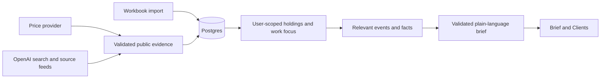

# Morning Brief: live market implementation plan

Prepared October 9, 2026. This is a product and engineering plan based on the current repository and the supplied workbook. Application code and database records have not been changed.

## 1. Product outcome

Give each salesperson a clear, current market brief built from their assigned clients' holdings and their own work focus. The brief answers: what happened, which holdings it touches, which clients are exposed, and why it matters. All prices, events, client records, and assignments must have an identifiable source.

The first release has two salespeople, three investment-manager clients, five fund accounts, and five positions imported from `C:\Users\Mridul\Downloads\Sample Data.xlsx`. Use the workbook as supplied client data; its contents are not independently verified real-world customer records.

Requirements:

- Real market snapshots with actual quote timestamps and session labels.
- Current-day news covering held companies, relevant sectors and products, major macro events, oil, geopolitical developments, AI, launches, and announcements.
- Personalization from the union of client holdings and explicitly saved salesperson work focus.
- Remove Today, Call list, call-priority features, and visible demo/process monitoring.
- Read people, clients, accounts, assignments, and positions from the database only.
- Use the existing OpenAI key only; no Gemini integration or credentials.
- Plain-language explanations with linked evidence and explicit uncertainty.
- Autonomous ingestion and regeneration driven by schedules, new evidence, and changed client coverage.
- A client dropdown on the brief: All my clients by default, or one assigned client with all its fund accounts.
- Download a PDF of the exact visible report version, selection, data cutoff, and filters for the salesperson to share with traders.

## 2. Findings in the existing application

| Area | Current behaviour | Required change |
| --- | --- | --- |
| Date | `src/lib/config.ts` defaults to October 5, 2026 | Runtime date and market calendar; fixed dates reserved for tests |
| Startup | `bootstrap.ts` can seed/reset a synthetic world and start a pipeline from database initialization | Explicit import/migrations; remove automatic synthetic seeding and request-triggered background work |
| Market provider | `market/index.ts` only registers `SimulatedProvider` | Register a real provider and fail clearly when unavailable |
| News and calendars | `feeds/connectors.ts` and `feeds/content.ts` generate stories, figures, calendars, and sector performance | Replace active connectors; synthetic modules remain test fixtures only |
| AI | `ai/gateway.ts` calls OpenAI Chat Completions without web search | Separate current-web discovery from evidence-based writing; add OpenAI Responses search |
| Brief architecture | Pipeline generation is coupled to ranked calls and call cards | Build a brief for every active salesperson even with zero call candidates |
| Screens | Today, Today's brief, Morning brief, Call list, and operations pages | One brief entry point, Clients, and simple Preferences |
| Client model | Required AUM, segment, risk, contacts, and a client/ticker position key | Support manager → account → position; allow unavailable metadata |
| Identity | Selecting an active profile ID creates a session | Real authenticated identity required for production; a profile picker only in explicitly local pilot mode |
| Retrieval | `getBundle()` returns the latest published brief regardless of its date | Current-day selection; older brief explicitly dated and never presented as current |
| Preferences | Existing changes take effect on the next business day | Recalculate today's relevant coverage after an authorized change |

The user's request for real publishers, issuers, and news supersedes the synthetic-content restrictions in `CLAUDE.md`. Update that documentation during implementation. Retain numeric validation, source timestamps, row-level security, and server-side secrets.

## 3. Workbook import and small client book

Verified source range: `Sheet1!A1:J6`, with five records. The file also contains an isolated backtick at `H13`; report that cell as a rejected stray row rather than treating it as a position.

| Proposed salesperson | Investment manager | Account | Client fund | Underlying | Direction |
| --- | --- | --- | --- | --- | --- |
| Salesperson 1 | X Capital Management | XC123 | X Capital 2X NVDA Fund | NVDA | Long |
| Salesperson 1 | X Capital Management | XC456 | X Capital 2X TSLA Fund | TSLA | Short |
| Salesperson 1 | Z Investments | ZC123 | Z Investments 2X AMZN Fund | AMZN | Long |
| Salesperson 2 | Y Shares | YC123 | Y Shares 2X INTC Fund | INTC | Long |
| Salesperson 2 | Y Shares | YC456 | Y Shares 2X MRVL Fund | MRVL | Long |

Use two selected existing sales-profile identities for the pilot; the table labels are planning placeholders. Keep management and account ownership together. The default holding universes are `{NVDA, TSLA, AMZN}` and `{INTC, MRVL}` respectively. One salesperson can own all three managers if desired without changing the schema.

### Mapping and source issues

| Workbook column | Database meaning |
| --- | --- |
| Investment Manager | Client manager name |
| Account | External account identifier, preserved as text |
| Client Fund | Account/fund display name |
| Direction | Explicit long/short direction |
| Ticker | Underlying symbol, resolved against provider reference data |
| Quantity | Imported quantity; unit recorded separately |
| Current Market Value | Source valuation, distinct from any live valuation |
| Initial Market Value | Source initial valuation; not assumed to be share cost |
| Spread | Raw numeric value with unit unconfirmed |
| Margin | Raw numeric value with unit unconfirmed |

The five current-market-value cells total 102,000,000 and initial-market-value cells total 1,800,000, in unspecified currency. TSLA alone has current value 100,000,000 versus initial value 400,000. Preserve these values, flag the outlier, and do not silently correct it. Do not use these figures for financial exposure weighting until their meaning is confirmed.

Missing information: valuation date, currency, quantity units, spread units, margin units, and product structure. A fund name containing “2X” is not sufficient evidence to multiply its holding or calculate leveraged returns. The underlying ticker is suitable for news matching, but not necessarily for valuing the fund.

Do not invent AUM, client segment, relationship dates, risk appetite, contacts, trades, or interaction history. Remove those fields from the pilot views or show them only when supplied. Import time is not a substitute for the source valuation date.

### Import workflow

1. Implement a command-line import with a read-only dry-run report first.
2. Validate exact headers, required identifiers, numeric values, direction, duplicate/conflicting rows, and symbols. Do not execute spreadsheet formulas or macros.
3. Store file hash, sheet, source row, raw fields, parser version, and validation issues in import tables. Keep the original workbook outside public assets and Git.
4. Resolve securities using symbol plus exchange/reference identity; quarantine ambiguous matches.
5. Upsert managers, accounts, positions, and the explicit coverage mapping in one transaction. The same file must produce the same records on re-import.
6. Separate raw staging from accepted typed data. Unknown currency/date can remain null; exclude dependent financial calculations until confirmed.
7. Verify three managers, five accounts, five positions, four long positions, one short position, and the source totals.
8. Archive/deactivate the previous demo dataset and unused profiles during controlled cutover. Preserve a database backup and verify foreign-key dependencies before any cleanup. Do not reset the whole database on app startup.

## 4. Current-day and market-session rules

Use US equities as the initial market because the supplied symbols are US-listed. Use `America/New_York` for the brief/news day and all displayed dates and times, including daylight-saving changes. This convention is confirmed by the user.

- Derive the current date at runtime. Store timestamps in UTC and an explicit market/brief timezone.
- Current-day news means a confirmed event, announcement, or material update during that day's timezone boundaries, up to the refresh cutoff.
- Store event time, first publication time, update time, and discovery time separately. Today's republication of an old launch is not a new launch.
- If the event's date cannot be verified, exclude it from the main current-day feed. Do not trust “today” in a model response.
- Exclude future events from “What happened.” If needed, put confirmed upcoming events in a clearly labelled separate section.
- On weekends and holidays, current-day news can still appear. Quotes must identify the last trading session and say “Market closed.”
- Before the open, show current pre-market quotes only where the feed provides them. Otherwise identify the previous close. Distinguish regular and extended hours.
- Use exchange holidays, early closes, and daylight-saving changes; weekday-only helpers are insufficient.
- Display one snapshot cutoff and per-value timestamps. Never relabel an older quote or brief with the current date.

## 5. Prices and market snapshots

Keep numerical market data independent from model-generated news. The model does not invent, estimate, or scrape stock prices to fill missing quote fields.

Updated direction: the initial release has no market-data API credentials. Build a source-neutral public-data adapter first, using official downloadable data and permitted public quote pages. Target a real **latest available** snapshot with per-card dates and delayed/daily labels. Do not promise all eleven cards are live intraday figures. Public visibility does not establish permission or reliable automated access.

| Screenshot metric | No-key candidate | Required label/constraint |
| --- | --- | --- |
| S&P 500, Nasdaq 100, Russell 2000, Dow | Public index quote pages | Verify exact index, observation time, previous close, allowed retrieval and display. Nasdaq Composite is not Nasdaq 100. Public-page retrieval remains a feasibility gate. |
| 10Y and 2Y yields | US Treasury published daily par yield curve CSV/XML | Daily Treasury par yield, observation date; not an intraday on-the-run quote |
| HY spreads | FRED ICE BofA US High Yield OAS series | Daily close, potentially older observation; publication/reproduction restrictions require review. Keep this card absent or link-only until its intended use is allowed. |
| VIX | Cboe official historical daily-close download | Latest daily close and observation date. Do not scrape Cboe delayed quote tables, whose page expressly prohibits automated extraction. |
| Gold and silver | Public delayed commodity quote pages | Name the actual spot/futures instrument, futures contract, currency/unit and delay. Exact permitted automated access must be verified. |
| WTI crude | EIA daily WTI spot price table/download, or permitted delayed futures page | EIA observation date may lag today. Label spot versus the named futures contract accurately. |

Verified public references: [Treasury rates and CSV/XML downloads](https://home.treasury.gov/resource-center/data-chart-center/interest-rates/TextView?type=daily_treasury_yield_curve), [Cboe daily VIX history](https://www.cboe.com/tradable-products/vix/vix-historical-data), [EIA WTI spot observations](https://www.eia.gov/dnav/pet/hist/RWTCD.htm), [FRED HY OAS series and usage notes](https://fred.stlouisfed.org/series/BAMLH0A0HYM2), [public commodity futures display](https://ca.finance.yahoo.com/markets/commodities/?pt=3).

During research, direct Yahoo retrieval returned rate-limit/cache errors and the CNBC page denied the search crawler. Search results showing a quote are not proof of dependable current-page ingestion. Run source-specific retrieval and usage checks before committing to automatic intraday coverage. Do not bypass access controls or substitute a stale search snippet.

Prefer deterministic parsing of published source values. AI can locate candidate sources and help explain the resulting snapshot, but model-generated figures and inferred quote times are not accepted numerical evidence. Store the original observed value, unit, date, instrument and URL; calculate changes only when a compatible previous observation exists. A new fetch time must never replace the observation date. Cache permitted quote-page results conservatively (initial target 30 minutes) and check daily datasets for publication updates. A failed source leaves a dated last-known value or an unavailable card, never a synthetic substitute.

If dependable current intraday coverage becomes necessary, a provider-neutral API adapter remains the upgrade path. Massive is a candidate subject to entitlement and display rights. [Massive ticker snapshots](https://massive.com/docs/rest/stocks/snapshots/single-ticker-snapshot).

Alpaca is an alternative. Its IEX feed is a limited-exchange feed; SIP provides consolidated coverage and requires the relevant entitlement. Label the actual feed and do not present IEX as a whole-market consolidated price. [Alpaca market-data FAQ](https://docs.alpaca.markets/us/docs/market-data-faq).

Provider selection must verify: covered exchanges, extended hours, previous close, corporate-action adjustments, index access, quote delay, rate limits, history, redistribution/display permissions, and budget. An OpenAI key does not grant market-data entitlements.

Snapshot contents:

- The salesperson's held underlying symbols, with name, last price, daily change, session, quote timestamp, and source.
- A compact broad-market context row when available: licensed benchmark indices, or accurately labelled ETFs as proxies. SPY is not the S&P 500 index and QQQ is not the Nasdaq index.
- Optional oil, volatility, rates, and dollar observations only if an authoritative numeric feed covers the named instrument. Do not use an oil ETF and call it spot crude.
- Movers limited to the salesperson's union of holdings and saved work focus; broad context stays separate.

Compute share price percentage changes in code from a consistent previous official close. Retain explicit unit rules: equity/index display conventions must be applied deliberately, yields/spreads use basis points, and level values retain their units. Add adjustment/session metadata. Never compare adjusted history with an unadjusted previous close.

Store observed and fetched timestamps, provider/feed, delayed status, session/trading date, and completeness. Validate finite/positive prices, valid previous closes, future timestamps, symbol matches, and stale records. Preserve missing values as unavailable.

## 6. Discover current news with OpenAI

`gpt-6-luna` supports web search through the Responses API. The current Chat Completions implementation has no web-search tool, so its model key alone does not retrieve live stories. Add a separate search adapter using Responses with `web_search` and live access enabled. Preserve returned citations and require evidence of an actual search. Account/tool access still needs an integration check. [GPT-6 Luna model](https://developers.openai.com/api/docs/models/gpt-6-luna), [OpenAI web search](https://developers.openai.com/api/docs/guides/tools-web-search).

### Retrieval lanes

1. **Company events:** held tickers, aliases, earnings, guidance, acquisitions, legal/regulatory decisions, product launches, leadership changes, and material contracts.
2. **Industry and AI:** semiconductors, cloud spending, chip supply, export restrictions, competing launches, AI infrastructure, and customer announcements relevant to the actual holdings.
3. **Macro and geopolitical:** oil supply shocks, war developments, sanctions, trade restrictions, shipping disruption, rate decisions, inflation releases, and major policy announcements.
4. **Source feeds:** licensed news APIs, company investor-relations/newsroom announcements, SEC filings, and relevant official releases. Use search for coverage gaps; do not rely solely on a model's chosen search queries.

SEC submissions APIs can supply filing discovery; link to the original filing and verify its timing and contents. [SEC EDGAR APIs](https://www.sec.gov/search-filings/edgar-application-programming-interfaces).

Search public company and market terms only. Never send client names, account numbers, holdings sizes, margin, spread, or private CRM notes to external search. Public retrieval can be shared across the firm; client matching happens afterward under the salesperson's permissions.

### Evidence admission

- Preserve canonical URL, publisher, source identifier, linked evidence, relevant source passage where storage is allowed, and all date fields.
- Prefer original company/exchange/regulatory sources for announcements. For breaking geopolitical stories, distinguish independently sourced reporting from syndicated copies.
- A search citation establishes where a claim came from, not that its date or interpretation is correct. Verify the current-day event against the source. Exclude inaccessible/unverifiable items from the main factual feed or use another admissible source.
- Deduplicate canonical URLs and group coverage of the same event. Keep a material new update without counting syndicated versions as multiple developments.
- Record corrections and retractions, invalidating the affected summaries and briefs.
- Keep public article content as untrusted input. It must not issue instructions, reveal secrets, trigger actions, or choose database access.
- Comply with search attribution requirements and feed storage/display rights. Store permitted excerpts and metadata rather than assuming unrestricted full-article storage.

No search service guarantees exhaustive, instantaneous coverage of every internet announcement. The product promises verified findings as of a visible cutoff; it must not claim that no event occurred merely because search returned nothing.

## 7. Personal relevance and impact

For salesperson S:

`holding universe = distinct underlying securities in all active accounts assigned to S`

`work universe = explicitly saved sectors, products, and followed securities for S`

`relevant coverage = holding universe UNION work universe UNION material market-wide events with an explained connection`

Holding coverage is mandatory. Preferences can add coverage, but must not silently exclude a client's held security. With no holdings and no saved work focus, show an honest setup/empty state; never use arbitrary desk defaults as real client coverage.

Match in code before writing: exact resolved security, verified industry/supply-chain relation, explicit work-focus relation, or a material macro transmission channel. Broad stories require an explanation of the connection; “war” or “AI” alone is insufficient.

Examples below are hypothetical matching rules, not current news:

- A confirmed NVIDIA launch matches the NVDA account directly. It may match INTC/MRVL as an industry development only with a supported competitive or customer connection.
- A confirmed export restriction affecting chip sales can touch NVDA, INTC, and MRVL; match the countries/products named in the policy.
- Oil supply disruption may affect inflation, shipping, or input costs. Include its relevance to the book only when that link is defensible, and distinguish broad market context from direct company exposure.
- A rise in TSLA is adverse to a short underlying exposure; a decline is adverse to a long underlying exposure. Actual fund performance still depends on the unconfirmed product structure.

Rank news by direct match, materiality, source quality, freshness, and demonstrated scope. Start with transparent ordered rules, not the existing call-opportunity score. Enable exposure weighting only after imported amounts, currency, and product meaning are validated. Diversify the first few stories so one topic does not overwhelm the brief.

Each item shows: what happened, time, affected underlying symbols, the user's affected client/accounts, “Why it matters,” and sources. Separate observed prices, reported facts, and possible implications. Do not claim a news story caused a price move solely because both happened nearby, or promise the next market direction.

## 8. Writing, model configuration, and secrets

Maintain separate interfaces for public-web discovery, evidence extraction, and final narrative writing. Do not route all three through the existing plain completion method.

Add server-only configuration: `OPENAI_API_KEY`, `OPENAI_MODEL=gpt-6-luna`, `CRON_SECRET`, `DATABASE_URL`, `SESSION_SECRET`, authenticated identity settings, and quote/news freshness settings. Keep secrets server-side and never print their values.

Keep the existing fact-token invariant for final generated prose: all numbers and digit-bearing names are registered evidence facts and substituted by code. Raw source headlines can retain their original content as source data; do not weaken the prose validator to accept invented numbers. Add claim-to-source checks, known-symbol checks, date validation, and cautious impact wording.

Public evidence may be read through service access. Private client context passed to a writer must be loaded with `db.asUser(profileId, ...)`, following repository rules. Prefer composing client/account labels and position direction in code so public summarization does not need private identifiers.

Cache public discovery by provider, query universe, date window, cutoff, and retrieval-policy version with a bounded TTL. Cache final writing by provider/model, evidence version, facts, coverage version, preferences version, date, and prompt version. Prevent cross-user private-cache reuse. A new event, correction, assignment, preference, or date boundary must invalidate the affected result.

If a model fails, render deterministic summaries from validated evidence. If retrieval fails, retain only correctly dated evidence and show the last successful update. Never fall back to synthetic quotes or invented news.

## 9. Database and refresh architecture

Keep Next.js, TypeScript, Postgres/Supabase, the existing DB abstraction, UI primitives, and fact rendering. PGlite remains useful for isolated local testing; production uses configured Postgres.

Proposed additive migrations:

| Data | Change |
| --- | --- |
| Imports | Batches, staged rows, validation issues, file hashes, provenance, and accepted/rejected status |
| Clients | Investment-manager identity; unsupported demo metadata becomes nullable |
| Accounts | Manager foreign key, external account key, fund name, currency and source date |
| Positions | Account foreign key, underlying instrument, explicit direction, raw quantity/value/spread/margin, units, provenance, and version |
| Instruments | Provider mappings, exchange/security identifiers, real issuer names and classification; avoid symbol-only ambiguity |
| Quotes | Provider/feed, observed/fetched times, trading date/session, delay/quality and adjustment metadata; maintain immutable history plus current view |
| News | Evidence/source records, canonical events, event/source dates, verification/correction state, multi-security and topic links |
| Matches | Per-profile/coverage-version event matches with reasons; user-specific client/account links protected by RLS |
| Briefs | Snapshot cutoff, input versions, per-section quality, immutable revisions, and date-aware current view |
| Refresh jobs | Durable queue/lease, attempts, next retry, heartbeat, result, and checkpoint |

Use account-level position identity; the existing `(client_id, instrument_id)` key loses separate fund accounts holding the same underlying. Preserve long and short legs independently. Use numeric decimals for money and quantity.

Apply row-level security to accounts, positions, assignments, private matches, briefs, chat, and private caches. Match output must be inaccessible after coverage is revoked, even if an older brief/cache referenced that client. Public news is shareable; private client relationships are not.

Autonomous refresh is part of the required first product release, with fast cached page reads. Use a protected scheduler and durable, bounded refresh jobs; do not rely on `void ensureWorld()` inside `getDb()`. The existing deployment allows 60-second API functions, so split retrieval and writing into resumable batches with checkpoints. A POST enqueues work; GET reads validated DB results and never launches a pipeline. Explicit refresh is an additional user action, not the only ingestion trigger.

Initial cadence targets with no market-data credentials: check permitted quote pages approximately every 30 minutes, check official daily datasets around publication windows, retrieve current news every five minutes during the supported business window and every 15 minutes outside it, and regenerate affected summaries when evidence changes. These are scheduling targets subject to source permissions, request limits and AI-search budget. A licensed streaming/API source can later support a faster snapshot schedule. “Real-time” labels depend on the upstream feed; polling frequency does not turn delayed data into real-time data.

Use locks/leases to prevent duplicate runs, bounded retries with backoff, per-provider circuit breakers, pagination/watermarks with overlap for late arrivals, and atomic publication of complete brief versions. Retain old valid values through failures with their original dates. Mark section-specific outages without withholding unrelated verified news. Internal logs and alerts remain operational tooling, outside the salesperson interface.

## 10. User interface and removals

Primary navigation: **Market brief**, **Clients**, **Preferences**. The Market brief header includes the current salesperson, client dropdown, data cutoff, and Download PDF. Keep optional existing Ask functionality only if it can consume the same verified facts and respect coverage; simplify its traces to linked sources rather than visible execution steps.

- Make `/brief` the homepage and consolidate the useful `/today-brief` dashboard into it. Keep document/print as a view action, not a second daily navigation tab.
- Remove `/today` and `/calls` pages, mobile/navigation entries, command-search items, call badges, card actions, call-list sections, and client-detail call links.
- Redirect old daily-view links to `/brief`; retire mutation endpoints for removed call actions. Do not leave reachable call-card behaviour behind a hidden menu.
- Remove user-facing Morning run, Data feeds, QC review, Deliveries, Demo control, process banners, simulated clocks, step logs, and boot-progress links. Retire demo reset and outage-simulation endpoints. Retain required quality checks privately.
- Disable call generation/ranking and simulated delivery in the active refresh path. Existing call-history tables can remain archived until their dependencies are safely removed.
- Reduce active user records to the two pilot salespeople. Keep only necessary authenticated service/admin access without populating extra demo personas.
- Show Clients as three managers containing five fund accounts. Position rows include fund, underlying, long/short, source values with their known units/date, live underlying quotes, and relevant verified news.
- Remove fabricated CRM sections and unsupported AUM/tier/risk fields.
- Replace “Catalysts” with “What moved markets,” “Book” with “Client holdings,” and technical/internal labels with ordinary product language. Explain necessary financial terms briefly.

Brief layout: date and market session, compact market snapshot, the most important relevant developments, client/holding matches, then other material market context. Every story has a source link and timestamp. Show only short factual states such as “Updated 10:42 ET,” “15-minute delayed,” “Market closed,” or “Prices unavailable.” These describe data quality rather than background processes.

Provide distinct states for no relevant verified news, missing holdings, incomplete news coverage, source outage, and an explicitly dated older brief. Do not use a blank list to imply successful comprehensive retrieval.

## 11. Ordered implementation work

| Phase | Concrete deliverable | Exit gate |
| --- | --- | --- |
| 1. Baseline and contract | Backup/inspect current DB, decide currency/date/units, provider entitlements and date convention; preserve existing uncommitted work | Written data contract and dry-run import report; no destructive reset |
| 2. DB and import | Add account/import/position schema and RLS, run idempotent workbook importer, create two assignments, stop demo seeding | Exactly 3 managers, 5 accounts, 5 positions; values preserved; other salesperson's records denied |
| 3. Market data | Real security master, quote/history adapter, session/calendar handling, quality rules | Five symbols correctly resolved; provider comparisons and market-closed tests pass |
| 4. Current evidence | OpenAI Responses search, primary-source connectors, date admission, deduplication | Current-day sourced event records; old republications excluded; failed search handled honestly |
| 5. Personalized brief | Union coverage, explicit relevance reasons, evidence/fact builder, provider-neutral writer, deterministic fallback | Different holding feeds for the two salespeople; macro/AI stories require relevant connections |
| 6. UI simplification | Consolidated `/brief`, lean client/account views, preferences, removed pages and cross-links | No Today/Call list/process UI; DB-backed user/client lists; complete loading/empty/error states |
| 7. Production reliability | Auth identity binding, durable refresh, protected scheduler, retries, version publication, quotas, corrections and logs | No arbitrary-profile impersonation; timeouts/restarts recover; stale values correctly labelled |
| 8. Release | Data reconciliation, user walkthrough, documentation update, rollback rehearsal | Acceptance checklist passes against actual providers and the imported book |

Relevant existing files: `src/lib/bootstrap.ts`, `config.ts`, `db/`, `market/`, `feeds/`, `pipeline/run.ts`, `brief/build.ts`, `brief/prefs.ts`, `ai/gateway.ts`, `ai/cache.ts`, `ai/validator.ts`, `data/clients.ts`, `data/brief.ts`, `auth/session.ts`, `components/shell/nav.ts`, `components/brief/`, and affected `app/` routes. Add focused import, evidence, coverage, and refresh modules; do not build a separate application.

The critical dependency order is **data contract → accounts/import/RLS → live quotes and news evidence → union matching → brief writing → screen consolidation → production refresh/auth validation**. UI removal can proceed alongside adapter development once the data contract is stable.

## 12. Acceptance and verification

- Import reruns create no duplicates; the rejected H13 cell is reported. Source totals reconcile and unconfirmed units remain unconfirmed.
- A fresh DB/app start never generates synthetic clients, instruments, prices, calendars, or events in the live mode.
- Salesperson 1 has the assigned X/Z accounts and Salesperson 2 has Y accounts. Test direct URLs, search, chat, private caches, matches, and exported briefs for cross-user access.
- Adding another held ticker changes that salesperson's universe without code changes. Removing coverage removes private access and invalidates affected results.
- Held tickers remain covered when saved work preferences change. Preferences add an explicit second coverage reason and apply to the current day.
- Quotes identify the provider, true observation time, feed delay, and session. Daily changes match an independently checked provider response with specified rounding tolerances.
- Test midnight in New York versus India, daylight-saving transitions, holidays, early closes, pre-market, regular hours, and weekends.
- Current-day selection rejects old events republished today, future events, unverifiable dates, and stale cached searches. Major new updates remain distinguishable from older stories.
- News deduplication preserves one event with multiple sources. Corrections retract affected claims and trigger new brief versions.
- Test hypothetical oil disruption, chip export rules, AI launches, and company announcements against relevant and irrelevant books. Test adverse/favourable direction for long and short underlying exposures without inventing fund P&L.
- All generated numeric prose uses registered facts; unsupported names, unknown tokens, fabricated citations, instructions embedded in articles, and unsupported causal claims are rejected.
- Model outage produces a readable factual fallback. Quote outage does not fabricate a price or hide valid news. Retrieval outage does not say “Nothing happened.”
- Pages remain DB-only and fast with providers unavailable. Refresh jobs survive retry, restart, concurrent requests, and function time limits without duplicate publication.
- No removed tabs, call-list links, call actions, process banners, simulated timestamps, or demo-reset endpoints remain active.
- Run typecheck, lint, unit/integration tests, production build, and browser QA after code implementation. Test provider schemas with permitted recorded fixtures and small live smoke checks; do not create brittle tests against today's changing headlines.
- Before production, validate actual account/tool access, quote/news entitlements, data display rights, authenticated user mapping, and operational refresh budgets.

## 13. Decisions and dependencies

Defaults in this plan: two salespeople; X/Z versus Y assignments; US-equity market session; current-day New York news; one consolidated brief; server-only provider integrations; invisible operational refresh.

The supplied workbook is real anonymised client data. Import it faithfully and preserve every numeric field. Currency, valuation date and financial units are unspecified, so ticker relevance and position direction can be shown without calculating inferred exposure or P&L. OpenAI-only and US/ET dates are confirmed. Remaining rollout inputs are verified production identities, hosting eligibility, and source access and display permissions.

Use OpenAI for current-web news discovery and evidence-based writing. Numerical data initially comes from validated public downloads and permitted pages. Source dates, access and display rights, and honest freshness labels remain required.

## 14. Autonomous client-filtered briefing for Cantor Fitzgerald

The intended workflow is now explicit: the system knows each salesperson's assigned clients and their holdings, gathers public market/news evidence autonomously, maintains a combined relevant-news view, allows client selection on that page, and exports the selected view as a PDF that the salesperson can share with traders. This is a proposed product for Cantor Fitzgerald; no access to its actual systems or firm policies is assumed.

### Collection universe and visible universe

- **Firm collection universe:** distinct underlying securities across all active clients/accounts in the database. Retrieve public information once per security/topic rather than once per client. This captures the union of news for the entire imported book.
- **Salesperson default view:** union of relevant events for every client currently assigned to that authenticated salesperson, with explicit work-focus additions and relevant broad-market context.
- **Selected-client view:** holdings and matched events for that one authorized manager client, including all its assigned fund accounts. For X Capital Management, the initial view covers NVDA long and TSLA short. For Y Shares, it covers INTC and MRVL long. Z Investments covers AMZN long.
- **Firm-wide view:** expose through a separately authorized desk/firm role if requested. Collecting public evidence for all holdings does not authorize revealing other salespeople's private clients or positions.

Deduplicate a shared event in the combined view and list all affected authorized clients. A selected-client view keeps that event only when the selected client's holdings or material market exposure match it. General work-focus stories belong to the combined view; they do not automatically appear as client-specific impacts. Broad-market snapshot cards can remain as clearly labelled context, while client holdings, relevant news, explanations and affected accounts change with selection.

### Required jobs

Use six background job types and an on-demand PDF job. A protected scheduler supplies recurring triggers; database changes and completed jobs supply event triggers. These are logical responsibilities, not seven mandatory servers or seven AI agents.

| Job | Responsibility | Trigger/output |
| --- | --- | --- |
| 1. Coverage and holdings sync | Import/update identities, client assignments, fund accounts, directions and underlying mappings; maintain coverage/position versions | Workbook import initially; future authorized firm source sync. Changed coverage produces an updated firm universe and affected user/client scopes. |
| 2. Market collection | Fetch permitted public quotes/downloads, parse exact values, validate dates and units, retain immutable observations | Source-specific schedule. Produces validated market snapshots; daily and delayed observations keep their real dates. |
| 3. News collection | Search held companies, related industries and material macro/geopolitical topics; collect original announcements and permitted source feeds | Business-window schedule and newly added underlying. Produces raw public evidence with retrieval cutoffs. |
| 4. Evidence processing | Verify source/event dates, resolve securities, remove duplicates, classify topics, group events and apply corrections | New/changed raw evidence. Produces admissible canonical events with source links and security/topic relations. |
| 5. Relevance matching | Join events to current holdings and work focus, calculate explicit client/account match reasons and direction-aware implications | Verified event, position, assignment or preference change. Produces versioned per-client and per-salesperson matches. |
| 6. Brief publication | Build validated facts and concise summaries; prepare combined and selected-client views; publish complete immutable report versions | Changed matches/quotes and a scheduled morning checkpoint. Produces published page data with source and input versions. |
| 7. PDF export, on demand | Render the exact authorized page version and selected filters with the same report template/data | Download PDF click. Produces a user-scoped downloadable artifact; the salesperson shares it with traders. |

Ordinary parsing, matching, scheduling, access checks and exports are deterministic code. Use OpenAI selectively for search discovery, evidence classification and concise writing, with the same verification rules and factual fallback. Do not pay for a model call per client when the underlying public event summary is reusable.

At pilot scale, one durable queue and one worker service with bounded concurrency can run the six background responsibilities. Run PDF rendering as a separately bounded task so an export cannot stall news ingestion. Scale ingestion and publication independently only when actual workload requires it. Long retrieval/model work must be resumable and fit deployment execution limits.

### Client dropdown and page contract

- Place a visible Client control beside Download PDF. Default value: All my clients. Populate options from current authorized database assignments, never hard-coded names.
- Selecting a client updates its header, funds/holdings, direct/related news, impact explanation and source list. Do not navigate to the old Today or Call list features.
- Persist selection in the URL, for example `/brief?client=<id>`, and validate it on the server. A manipulated ID must not expose another user's book.
- Switching client reads prepared report data from the database; it must not launch a new internet search. Display a short loading state and cancel obsolete requests so a slower prior selection cannot overwrite the current one.
- Keep an explicit current-view version/cutoff. If newer evidence arrives, offer an updated view or refresh it as a complete version. Do not mix an old headline with a newly fetched price inside one report snapshot.
- An assigned client with no matched verified events gets an honest empty state. An ingestion outage gets a different state identifying incomplete/older coverage.

### Exact-page PDF contract

Freeze `report_version_id`, authenticated user scope, selected client, active filters/order, market/news cutoffs, and display timezone when Download PDF is clicked. The PDF worker uses that snapshot, not whichever database version becomes newest during rendering. Recheck authorization at export time and at download; reject a report containing a client whose coverage has since been revoked.

Use one report view model and shared content components for the browser and print/PDF layout. Preserve all visible report content, selected-client identity, values, timestamps, source links and explanations. Adapt pagination and remove interactive controls from the document; do not silently omit cards or long news items. Distinguish user-visible content from browser navigation when defining “exact page.”

Serve the artifact through an authorized download rather than a public client-data URL. Record version/selection/export time in a private audit record. Let the salesperson download and send the PDF; automated distribution is a separate feature requiring recipients and an explicit sending workflow. Traders use the evidence and indicated data freshness when deciding their actions. The report separates observed facts from possible effects.

### Additional acceptance gates

- A scheduled run completes without an open browser or user clicking Refresh.
- New coverage/holdings are reflected in the collection universe and relevant user views; a revoked assignment cannot persist through cached pages, PDFs, search or chat.
- One event matching multiple holdings appears once in All my clients and shows the correct authorized affected accounts.
- Switching among X, Y and Z updates the full relevant report, with no results leaking from the previous selection. The firm collection universe remains the five supplied underlyings.
- Export All my clients and each authorized client. Compare the PDF against the visible version for scope, values, story order, source links and cutoff; visually inspect pagination, clipped tables and long stories during implementation.
- Insert new evidence while an export is queued: the downloaded PDF still matches the version the user selected.
- Test failed/retried exports, concurrent refreshes, corrections and stale source values. Export retries cannot regenerate a different report under the original version identifier.

Implement alongside the original phases: coverage versions in phase 2; collectors/evidence jobs in phases 3–4; relevance and publication in phase 5; dropdown and PDF action in phase 6; autonomous scheduling and execution recovery are release requirements, not optional follow-up work.

## Confirmed hosting constraint: Vercel Hobby

The user intends to host on free Vercel. Do not put an in-process node-cron loop in a Next.js function. Use authenticated, bounded HTTP work with durable Postgres checkpoints, leases, idempotency and retries. No ingestion starts as unawaited work during a page request.

Vercel Hobby includes cron, but each configured cron job can execute only once per day, with execution anywhere in the scheduled hour. A daily schedule cannot meet intraday market/news freshness. Do not deploy a five-minute Vercel cron expression on Hobby or stagger daily jobs to work around that limit. See [Vercel cron limits](https://vercel.com/docs/cron-jobs/usage-and-pricing).

For eligible personal development, an external scheduler such as [cron-job.org](https://cron-job.org/en/) can trigger the protected work endpoint every five minutes. Alternatively, an existing Supabase database can schedule HTTP work using [pg_cron and pg_net](https://supabase.com/docs/guides/functions/schedule-functions), with the secret held in Vault. Neither schedule has been configured externally. Keep the endpoint compatible with either scheduler; deployment URL and scheduler connection are rollout inputs.

Vercel cron does not retry failed invocations and may deliver duplicates or miss runs. Recovery must come from persisted jobs on the next trigger. Reject unauthorized calls before opening the database, never return holdings or keys to the scheduler, and revalidate US/ET day boundaries inside each job. See [Vercel cron operations](https://vercel.com/docs/cron-jobs/manage-cron-jobs).

Vercel Hobby is restricted to non-commercial personal use. The Cantor sales product must use an eligible hosting plan before commercial hosting; an external scheduler does not change this requirement. See [Vercel Hobby terms](https://vercel.com/docs/plans/hobby). Scheduler hosting can be free, but OpenAI API calls retain their separate usage costs.

## Implemented live workspace and remaining rollout inputs

The supplied workbook is imported into private client/account/holding tables and assigned to two active salesperson profiles. Live routes use those tables under RLS. The legacy synthetic pipeline is not invoked by page loads or the brief command.

A signed QStash endpoint executes the durable Postgres queue. Market and free publisher feed slots run every five minutes; optional sparse-feed AI discovery has a separate interval and global call cap. Nineteen publisher feeds cover markets, company/technology developments, energy, credit/economics and geopolitical regions. Current-day admission, source links, duplicate grouping, source failures and observation dates remain explicit.

The client/stock/topic/search controls share their filtering rules with PDF exports and assistant context. News opens inside an accessible modal. Effects buttons use matched holdings in the selected view and show conditional channels with evidence to check. Repeated generic long/short price-direction explanations were removed at the user's request.

The reader supports complete authorized original HTML without the former short-briefing truncation. Full-text redistribution is disabled by default; NEWS_FULL_TEXT_HOSTS requires confirmed source rights and is independent of the safe-fetch allowlist. Existing expanded briefings remain labeled as briefings. Summaries are labeled bullet points generated only on explicit request, cached by article/evidence and numerical-token validated. An excerpt-only source cannot supply a complete-article summary.

Remaining external inputs are the deployed HTTPS APP_URL, production sign-in configuration and an authorized full-text source. The production recurring schedule is not activated without APP_URL. Public-source availability does not establish redistribution permission. No commercial-readiness claim should precede source-rights confirmation, deployed scheduler verification, visual browser/PDF review and a successful real model integration check.
